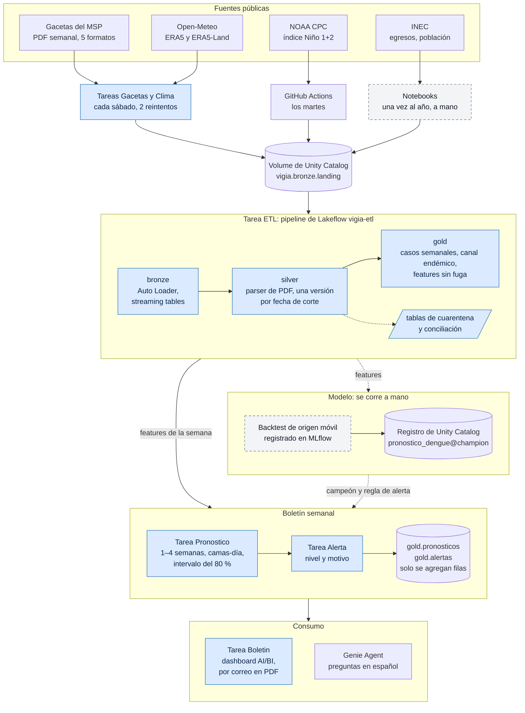
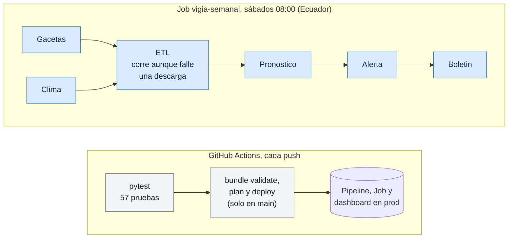
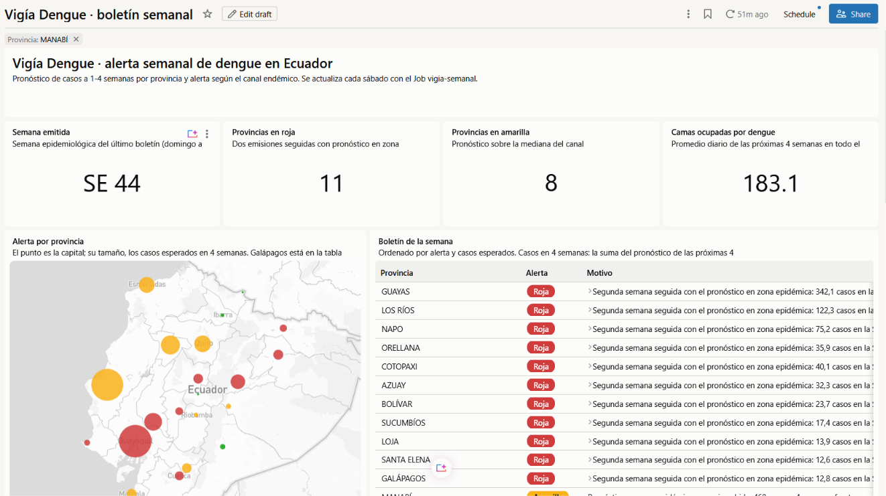
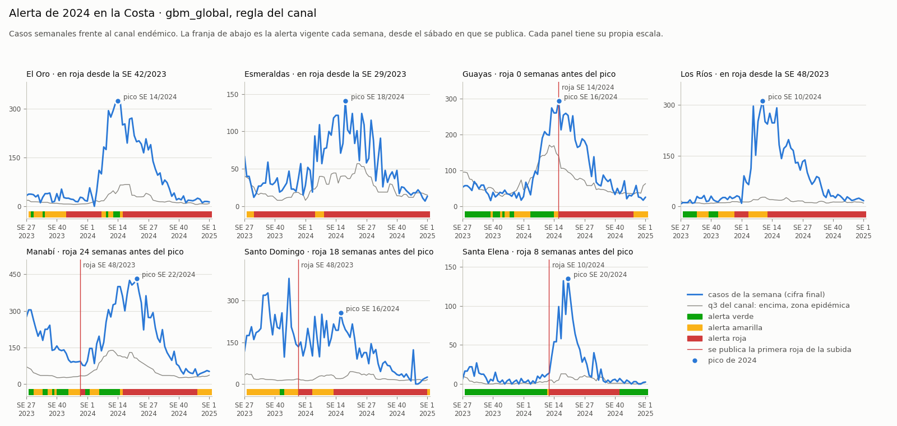

# Vigía Dengue: alerta temprana de dengue para Ecuador en Databricks

[English](README.md) · **Español**

[](https://github.com/srodriguez252/vigia-dengue/actions/workflows/ci.yml)

**En un backtest que solo usa las gacetas que estaban en línea cada semana, la alerta roja de Vigía Dengue se adelantó a 36 de 56 inicios de brote desde 2022, con 7 semanas de anticipación mediana. El promedio de las últimas 4 semanas, con la misma regla, se adelantó a 25.**

Cada sábado pronostica los casos confirmados de dengue de cada una de las 24 provincias de Ecuador a una, dos, tres y cuatro semanas, emite una alerta verde, amarilla o roja con su motivo y estima las camas-día de hospital que ocuparían esos casos. Corre de punta a punta en Databricks Free Edition.

## El problema

- Los casos de dengue en Ecuador se duplicaron con creces en un año: 61 400 casos confirmados en 2024 frente a 27 906 en 2023 ([gaceta del MSP, SE 42 de 2025](https://www.salud.gob.ec/wp-content/uploads/2025/10/Enfermedades-Trasmitidas-por-Vectores-DNVE-SE-42.pdf)).
- Las gacetas semanales del Ministerio de Salud Pública describen lo que ya pasó, en tablas en PDF con cinco formatos distintos desde 2017. Ninguna proyecta las semanas que vienen.
- El clima avisa: los pronósticos de El Niño anticiparon el pico de inicios de 2016 en Machala ([Lowe et al., 2017](https://par.nsf.gov/servlets/purl/10039611)), y en ese momento Ecuador no tenía un sistema oficial de alerta temprana de dengue ([LSHTM](https://www.lshtm.ac.uk/expert-opinion/can-climate-forecasts-predict-outbreaks)).

La decisión que apoya: a qué provincias enviar control vectorial e insumos antes del pico, no después.

## Cómo funciona



Las cajas azules corren dentro del Job `vigia-semanal`, cada sábado a las 08:00, hora de Ecuador. Las grises con borde punteado se corren a mano, y las flechas punteadas son el camino fuera de línea: el backtest lee las features de gold y deja en el registro el modelo campeón y su regla de alerta. El dashboard y Genie también leen las tablas gold del pipeline (`dengue_semana`, `canal_endemico`).

Las seis tareas del Job, y cómo les llega un cambio:



- **Ingesta.** Los notebooks de descarga y un workflow de GitHub Actions dejan los archivos crudos en un Volume de Unity Catalog. Auto Loader lee solo los archivos nuevos.
- **ETL.** Un solo Lakeflow Spark Declarative Pipeline (`vigia-etl`, 20 archivos) arma las tablas bronze, silver y gold, con expectations que descartan filas malas o detienen la actualización.
- **Modelo.** Un modelo de gradient boosting, elegido con un backtest de origen móvil y registrado en Unity Catalog con MLflow.
- **Corrida semanal.** Un Job de seis tareas pronostica las semanas que faltan, aplica la regla de alerta, estima las camas-día y manda el dashboard por correo en PDF.
- **Operación.** El pipeline, el Job y el dashboard son código en un Declarative Automation Bundle. GitHub Actions corre 57 pruebas en cada push y despliega el bundle cuando pasan en `main`.

## Resultados

Backtest de origen móvil: un pronóstico por semana epidemiológica (SE) desde la SE 1 de 2022, reentrenando cada 4 semanas, solo con las gacetas que estaban en línea en cada fecha de emisión.

**Qué sabía cada emisión.** Solo el 31 % de las emisiones semanales desde 2022 tenía la gaceta de su propia semana. Ninguna la tenía en 2022 y 2023, cuando el mes de subida es el único rastro y una gaceta cuenta desde el último día de ese mes; la tenía el 65 % en 2025 y el 75 % en 2026. Desde la SE 10 de 2024, cuando la fecha de subida de cada gaceta nueva se conoce al día, la tenía el 55 %, y el 84 % tenía datos de hace una semana o menos. Una versión anterior de este backtest tomaba la fecha de corte de cada gaceta como su fecha de publicación y ponía esa proporción en 92 %; los resultados de abajo reemplazan los que daba.

**Error del pronóstico.** Error absoluto medio, en casos por provincia y semana. Todos los pronósticos reducen el error del canal endémico entre un 37 % y un 46 %. Las dos líneas base sin modelo siguen teniendo el menor error medio, 14,0 y 14,1 casos, frente a 14,9 del campeón: queda 1,7 casos atrás a una semana y entre 0,2 y 0,4 a cuatro semanas.

| Modelo | 1 semana | 2 semanas | 3 semanas | 4 semanas | Frente al canal endémico |
| --- | --- | --- | --- | --- | --- |
| Última semana conocida | 11,9 | 13,4 | 14,7 | 16,1 | 0,54 |
| Promedio de las últimas 4 semanas (ingenuo) | 11,9 | 13,3 | 14,8 | 16,3 | 0,54 |
| **Gradient boosting con clima y El Niño (campeón)** | 13,6 | 14,4 | 14,9 | 16,5 | 0,57 |
| Gradient boosting sin clima | 13,5 | 15,2 | 15,9 | 17,8 | 0,60 |
| Gradient boosting, un modelo por provincia | 14,9 | 16,1 | 16,9 | 17,2 | 0,63 |
| Canal endémico, mediana | 25,8 | 25,9 | 26,0 | 26,1 | 1,00 |

**Alertas.** Una alerta pasa a roja cuando el pronóstico a 2–4 semanas supera el tercer cuartil del canal en dos emisiones seguidas. Se mide contra los inicios de brote: la primera de 4 semanas seguidas en zona epidémica después de 8 semanas de calma. Un inicio está avisado a tiempo si se publica una emisión en roja hasta 8 semanas antes, y tarde si la roja llega en las 4 semanas siguientes. Una racha de emisiones en roja es una falsa alarma si empieza en una semana de calma y ningún brote empieza entre 4 semanas antes y 8 semanas después de su publicación.

Todo el backtest, con 56 inicios de brote en 20 provincias desde 2022:

| Pronóstico detrás de la alerta | Avisados a tiempo | Avisados tarde | Sin aviso | Anticipación mediana (semanas) | Falsas alarmas por provincia y año |
| --- | --- | --- | --- | --- | --- |
| **Campeón** | 36 | 8 | 12 | 7 | 0,49 |
| Promedio de las últimas 4 semanas (ingenuo) | 25 | 10 | 21 | 5 | 0,34 |
| Última semana conocida | 23 | 18 | 15 | 5 | 0,37 |

El campeón avisa 11 inicios más que el ingenuo y da cerca de un 45 % más de falsas alarmas. En las emisiones desde la SE 10 de 2024, cuando la fecha de subida de cada gaceta nueva se conoce al día, avisó a tiempo 20 de 29 inicios, frente a 17 y 14, con 0,37 falsas alarmas por provincia y año, frente a 0,31 y 0,33. Las reglas más estrictas, que además piden que el pronóstico a 4 semanas llegue a 1, 1,25 o 1,5 veces el promedio de las últimas 4, avisaron 16, 15 y 10 de los 56 inicios.

**La epidemia de 2024 en la Costa.** La alerta estaba en roja en las siete provincias de la Costa antes de la subida de 2024. Santo Domingo, El Oro, Manabí y Los Ríos pasaron a roja entre septiembre y noviembre de 2023, con los casos ya sobre sus umbrales. Esmeraldas y Guayas pasaron a roja en diciembre, 20 y 16 semanas antes de sus picos, y Santa Elena el 10 de febrero, 13 semanas antes. Las alertas se sostuvieron a pesar de un hueco en los datos: ninguna gaceta está en la carpeta de subidas de enero de 2024. Las de las dos últimas semanas de 2023 y las ocho primeras de 2024 se subieron en febrero, dos de ellas en noviembre, y de diciembre a fines de febrero cada emisión trabajó con datos de 2 a 9 semanas de antigüedad. Manabí y Guayas bajaron a amarilla durante dos emisiones a inicios de marzo y volvieron a roja.





Los títulos de los paneles cuentan las semanas hasta el pico desde la primera emisión en roja de la subida, o dicen desde cuándo estaba en roja si la alerta ya estaba encendida. Las 18 semanas de Santa Elena empiezan en una sola emisión en roja de enero; la roja que se sostuvo empezó 13 semanas antes de su pico.

## Decisiones de diseño

- **Sin fuga.** Cada gaceta del MSP se guarda como una versión, con su fecha de corte y la fecha desde la que consta que estaba en línea. El Ministerio no publica cuándo sube cada PDF, y muchas gacetas se subieron semanas después de su corte, varias a la vez, así que la fecha de publicación sale de tres rastros: la cabecera `Last-Modified` del servidor, la carpeta del mes de subida en la URL y la primera corrida semanal que vio el enlace. Una gaceta cuenta desde la fecha más tardía que admiten esos rastros. Las features de la SE *t*, emitidas 7 días después del cierre de la semana, usan solo las gacetas ya publicadas ese día, y el modelo se entrena con los casos como se conocían el día del entrenamiento. Dos pruebas cambian todo lo que no se sabía en una fecha dada y exigen features y pronósticos idénticos.
- **Un parser de PDF que pone en cuarentena en vez de adivinar.** pdfplumber corre dentro de `mapInPandas` y lee cinco formatos de tabla, de 2017 a 2026, por la posición de cada número. Una gaceta que no puede leer con confianza va a una tabla de cuarentena, y cada gaceta con fila Total se concilia contra ella. Sus pruebas arman PDF mínimos con la forma de una gaceta y se los dan al mismo código que corre el pipeline, así que el repositorio no guarda ninguna gaceta.
- **Tasas a casos.** De mediados de 2025 a mediados de 2026 las gacetas publican solo tasas. Se convierten a casos con la población que usó el propio MSP, deducida de sus gacetas anteriores, y cada fila dice si sus casos vienen del PDF o son estimados.
- **La gaceta que trae el año anterior.** La fila Total de la gaceta de la SE 1 de 2025 suma todos los casos de 2024 a los 547 de su semana. Los casos semanales son lo que crece el acumulado más alto de cada año, así que esa sola gaceta le daba a Manabí 10 473 casos en la primera semana de 2025, casi todo su 2024, y cero en las otras 52 semanas. Se descarta una gaceta de las primeras 4 semanas del año cuando su acumulado nacional llega a la mitad del acumulado más alto del año anterior que se conocía cuando se publicó; su semana se completa como cualquier otro hueco, y una prueba reproduce el caso.
- **El canal endémico como referencia.** Para cada provincia, año y SE: los cuartiles de hasta 7 años previos sin epidemia ([Bortman, 1999](https://scielosp.org/pdf/rpsp/1999.v5n1/1-8/es)). Es a la vez la línea base que hay que superar y el umbral de la alerta.
- **El modelo.** `HistGradientBoostingRegressor` con pérdida Poisson, uno por horizonte, compartido por todas las provincias, con la provincia como variable categórica. Los casos entran desde la última semana con dato, junto con cuántas semanas tiene ese dato, para que una gaceta atrasada no deje al modelo sin un nivel de referencia. También usa su crecimiento, la incidencia por 100 000 habitantes, el canal endémico, banderas de calidad del dato, la época del año, la población, las anomalías de lluvia, temperatura y humedad, y el índice Niño 1+2 rezagado. El backtest lo comparó con el mismo modelo sin clima y con un modelo por provincia; el campeón es el modelo global de menor error medio. Tres líneas base sin modelo pasan por el mismo backtest y las mismas reglas de alerta: el canal endémico, el promedio de las últimas 4 semanas y la última semana conocida.
- **La regla de alerta.** Roja cuando, en dos emisiones semanales seguidas, el pronóstico a 2–4 semanas supera el tercer cuartil del canal (y 5 casos). Amarilla cuando el pronóstico supera la mediana del canal. El backtest se queda con la regla que avisa a tiempo más inicios de brote dentro de un presupuesto de una falsa alarma por provincia y año: pedir además un pronóstico a 4 semanas en subida avisó 16 de 56 en vez de 36.
- **Camas-día.** Casos pronosticados × hospitalizaciones por caso × días de estada promedio, con los egresos del INEC y los casos del MSP de 2017 a 2024. Las provincias con menos de 30 hospitalizaciones usan las tasas del país.
- **Emisiones que solo se agregan.** Cada corrida pronostica solo las emisiones que todavía no están en `gold.pronosticos` y las escribe con un `MERGE` por su clave: un sábado que falla se recupera la semana siguiente, una tarea que corre dos veces no agrega nada y las emisiones pasadas nunca se reescriben. El intervalo del 80 % sale de los errores del campeón en el backtest.
- **Fallas que avisan.** El boletín sale aunque falle una descarga, y alguien se entera. Cada emisión que toca ese día tiene sus features, con el clima vacío si no llegó. Una tarea de descarga falla, y manda su correo, cuando el clima de la semana está incompleto, cuando no se puede leer la página de las gacetas o cuando lleva más de 3 semanas sin salir una gaceta nueva. La tarea del pronóstico falla si la emisión que toca ese día no quedó escrita, en vez de mandar por correo el boletín de la semana anterior.

## Limitaciones

- **El modelo no le gana a las líneas base en error.** La última semana conocida y el promedio de 4 semanas se equivocan en 14,0 y 14,1 casos en promedio, y el campeón en 14,9; donde más pierde es a una semana, 13,6 frente a 11,9. Lo que aporta está en las alertas: avisa a tiempo 36 de 56 inicios de brote frente a 25, a cambio de 0,49 falsas alarmas por provincia y año frente a 0,34.
- **La métrica y un arreglo llegaron después de los primeros resultados.** Con las fechas de subida reales, el primer backtest no entrenaba con ninguna fila de 2020 a 2023, porque sus etiquetas pedían conocer cada semana 3 semanas después, y se equivocaba en 17,9 casos. Las etiquetas y las features de casos se cambiaron para resolver ese defecto, y los umbrales de la métrica de inicios de brote se fijaron antes de mirar sus números, pero todo se evaluó en el mismo backtest, sin un periodo reservado. Los 56 inicios son 5 de 2022, 16 de 2023, 8 de 2024, 9 de 2025 y 18 de 2026.
- **El clima aporta poco.** Con lluvia, temperatura, humedad y El Niño el error es de 14,9 casos, frente a 15,6 sin ellos: cerca de un 5 % menos. Pueden explicar parte el sesgo de la lluvia, descrito abajo, y una historia que empieza en 2017.
- **La lluvia está sesgada en la Sierra.** Las celdas de ERA5, de unos 28 km, mezclan valles y laderas: Quito suma hasta 3 518 mm en 2025, frente a unos 1 100 mm normales. Por eso la lluvia entra al modelo como anomalía frente a su propia climatología.
- **La zona epidémica es lo habitual.** El 45 % de las semanas-provincia desde 2022 está sobre el tercer cuartil del canal, el 64 % en la Costa, y Manabí estuvo sobre él 123 semanas seguidas, de la SE 21 de 2023 a la SE 39 de 2025. Una alerta roja dice que los casos están sobre la historia de la provincia, no que empieza un brote, y una provincia que ya está en roja no puede volver a avisar. Por eso las alertas se miden contra los inicios de brote: el paso de la calma a la epidemia.
- **Las gacetas tienen huecos.** De 2017 a 2026, 21 semanas nunca se publicaron, 3 enlaces están rotos y 4 PDF no se pueden leer, y las cifras se corrigen en gacetas posteriores. El crecimiento de un hueco se reparte en partes iguales entre sus semanas.
- **Las fechas de publicación son exactas solo desde marzo de 2024.** Las gacetas subidas desde entonces conservan su fecha original en el servidor, y siempre cae en el mes de la carpeta de su URL. Todos los archivos anteriores muestran la misma resubida masiva del 2 de marzo de 2024, así que la carpeta es el único rastro: esas gacetas cuentan desde el último día de su mes de subida, hasta un mes después de la subida real, y las de 2017 a 2019 sin un rastro útil siguen contando desde su fecha de corte. `publicacion_origen` marca cada caso, y `publicacion_desde` guarda la fecha más temprana posible, para repetir el backtest en el otro extremo del rango.
- **Los datos hospitalarios llegan tarde.** Los egresos del INEC se publican más de un año después, así que calibran las camas-día pero no alimentan el pronóstico semanal. Las camas-día son un orden de magnitud, no un plan de capacidad.
- **Canal corto.** El canal endémico necesita al menos 5 años previos, así que empieza en 2022 o 2023 según la provincia.
- **Límites de Free Edition.** Solo cómputo serverless, un solo pipeline, salida a internet limitada y el plan gratuito de Open-Meteo para uso no comercial, que reparte el histórico del clima en varios días.

## Estructura del repositorio

| Ruta | Qué tiene |
| --- | --- |
| `vigia-etl/transformations/` | Pipeline de Lakeflow: tablas bronze, silver y gold |
| `vigia-etl/utilities/` | Casos semanales, canal endémico y features (`features.py`) y la fecha de publicación de cada gaceta (`publicacion.py`); los usan el pipeline y las pruebas |
| `src/modelos/` | Backtest, líneas base, regla de alerta y métricas (`pronostico.py`); pronóstico semanal, intervalo y camas-día (`semanal.py`); escritura por clave de las tablas semanales (`tablas.py`) |
| `src/notebooks/` | Descargas, backtest, registro del modelo, pronóstico semanal y alerta |
| `src/dashboards/` | Definición del dashboard AI/BI |
| `src/setup/` | Catálogo, esquemas y Volume; los 221 cantones con su punto de clima (`cantones.csv`) |
| `databricks.yml`, `resources/` | Declarative Automation Bundle: pipeline, Job y dashboard |
| `tests/` | Pruebas de pytest: sin fuga, fechas de publicación, parser de PDF, backtest, boletín semanal y escritura de tablas |
| `scripts/` | Descarga del índice Niño y generador de `cantones.csv` |
| `.github/workflows/` | Descarga semanal del Niño; CI que prueba y despliega el bundle |

## Cómo correrlo

Necesitas un workspace de Databricks (Free Edition sirve), la CLI de Databricks 1.22 o posterior con sesión en el perfil `DEFAULT`, y un fork de este repositorio.

1. Corre `src/setup/00_crear_catalogo.sql` en el editor SQL: catálogo `vigia`, esquemas `bronze`, `silver`, `gold` y `ml`, y el Volume `landing`.
2. Agrega tu fork como Git folder en el workspace.
3. Copia los cantones al Volume y carga el histórico una vez corriendo estos notebooks de `src/notebooks/`: `descargar_egresos`, `descargar_poblacion`, `descargar_gacetas` y `descargar_clima`. El histórico del clima necesita varias corridas por el cupo gratuito de Open-Meteo; el notebook sigue donde quedó. El índice Niño sale del script que GitHub Actions corre cada martes:

   ```bash
   databricks fs cp src/setup/cantones.csv dbfs:/Volumes/vigia/bronze/landing/geografia/cantones.csv
   python scripts/descargar_fuentes.py --fuente nino --destino landing
   databricks fs cp -r landing dbfs:/Volumes/vigia/bronze/landing --overwrite
   ```

4. Pon el ID de tu SQL warehouse en `resources/vigia_dengue.dashboard.yml` y `resources/vigia_semanal.job.yml`, y luego despliega y arma las tablas:

   ```bash
   databricks bundle deploy -t prod
   databricks bundle run vigia_etl -t prod
   ```

5. Corre los notebooks `backtest`, `por_provincia`, `alertas` y `registrar`, en ese orden. Escriben las tablas del backtest y registran `vigia.ml.pronostico_dengue` con el alias `champion`.
6. Corre el Job semanal una vez: `databricks bundle run vigia_semanal -t prod`. Después corre solo cada sábado.
7. Para CI, agrega los secretos del repositorio `DATABRICKS_HOST` y `DATABRICKS_TOKEN`. Para correr las pruebas en local (Python 3.12 y Java 17):

   ```bash
   pip install pyspark==4.0.1 pytest==8.4.2 scikit-learn==1.7.2 pandas==2.3.3 numpy==2.3.4 matplotlib==3.10.6 pdfplumber==0.11.7
   pytest tests
   ```

## Fuentes de datos y licencias

El repositorio no redistribuye datos crudos: los notebooks bajan cada fuente a un Volume de Unity Catalog. El único dato derivado que se guarda aquí es `src/setup/cantones.csv`.

| Fuente | Para qué se usa | Licencia |
| --- | --- | --- |
| [MSP, gacetas de enfermedades transmitidas por vectores](https://www.salud.gob.ec/gacetas-vectoriales-2026/), 2017–2026 | Casos confirmados de dengue por provincia y semana | Publicaciones oficiales del Ministerio de Salud Pública del Ecuador |
| [INEC, camas y egresos hospitalarios](https://www.ecuadorencifras.gob.ec/camas-y-egresos-hospitalarios/), 2015–2024 | Hospitalizaciones y días de estada para las camas-día | Datos públicos del Instituto Nacional de Estadística y Censos |
| [INEC, estimaciones y proyecciones de población, revisión 2024](https://www.ecuadorencifras.gob.ec/estimaciones-y-proyecciones-de-poblacion-revision-2024/) | Población por cantón y año | Datos públicos del Instituto Nacional de Estadística y Censos |
| [Open-Meteo Historical Weather API](https://open-meteo.com/) | Temperatura, lluvia y humedad diarias por cantón | [CC BY 4.0](https://creativecommons.org/licenses/by/4.0/) |
| Copernicus Climate Change Service, ERA5 y ERA5-Land, a través de Open-Meteo | El reanálisis detrás de los datos del clima | [CC BY 4.0](https://creativecommons.org/licenses/by/4.0/) |
| [NOAA Climate Prediction Center, índices Niño semanales](https://www.cpc.ncep.noaa.gov/data/indices/) | Anomalía de la temperatura del mar en Niño 1+2 | Datos del gobierno de EE. UU. |
| CONALI, Organización Territorial del Estado (17 de julio de 2026), a través de [geoecu](https://cran.r-universe.dev/geoecu) | Cabeceras cantonales en `cantones.csv` | CC BY |
| [GeoNames](https://www.geonames.org/) | Lugar más poblado de cada cabecera cantonal en `cantones.csv` | [CC BY 4.0](https://creativecommons.org/licenses/by/4.0/) |

### Atribución

- [Datos meteorológicos de Open-Meteo.com](https://open-meteo.com/). Zippenfenig, P. (2023). *Open-Meteo.com Weather API* [Computer software]. Zenodo. <https://doi.org/10.5281/ZENODO.7970649>
- Contiene información modificada del Copernicus Climate Change Service 2026. Ni la Comisión Europea ni el ECMWF son responsables del uso que se haga de la información o los datos de Copernicus que contiene.
  - Hersbach, H., et al. (2023). *ERA5 hourly data on single levels from 1940 to present*. Copernicus Climate Change Service (C3S) Climate Data Store (CDS). <https://doi.org/10.24381/cds.adbb2d47>
  - Muñoz Sabater, J. (2019). *ERA5-Land hourly data from 1950 to present*. Copernicus Climate Change Service (C3S) Climate Data Store (CDS). <https://doi.org/10.24381/cds.e2161bac>
- Límites cantonales: Comité Nacional de Límites Internos (CONALI), Ministerio de Gobierno del Ecuador, *Organización Territorial del Estado*, versión del 17 de julio de 2026, CC BY, publicada por el paquete geoecu.
- Lugares: [GeoNames](https://www.geonames.org/), CC BY 4.0, a través del archivo cities500 del paquete geonamescache.
- Índice Niño 1+2: NOAA Climate Prediction Center, OISST v2.1 semanal, periodo base 1991–2020.
- Casos de dengue: Ministerio de Salud Pública del Ecuador, *Gacetas epidemiológicas de enfermedades vectoriales*.
- Egresos hospitalarios y población: Instituto Nacional de Estadística y Censos (INEC).

**Cambios realizados.** El clima se agrega por semana epidemiológica, se pondera por la población de cada cantón y se expresa como anomalía frente a la climatología de cada provincia. `cantones.csv` deriva un punto por cantón: el lugar de GeoNames con más habitantes dentro del polígono de la cabecera cantonal de CONALI, o el centroide del polígono si no hay ninguno.

## Aviso

Proyecto de portafolio, no una alerta sanitaria oficial. Usa solo datos públicos agregados, sin información personal. Los pronósticos y las camas-día tienen la incertidumbre descrita arriba y no deberían guiar decisiones reales sin la vigilancia del propio Ministerio de Salud Pública.

## Licencia

Código bajo la licencia MIT (ver [LICENSE](LICENSE)). Los datos conservan las licencias de sus fuentes.
