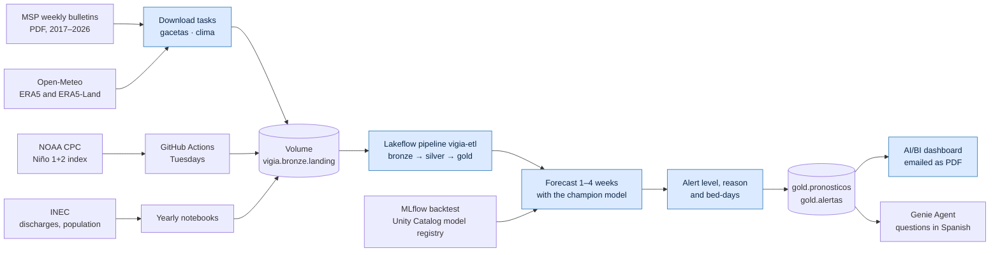
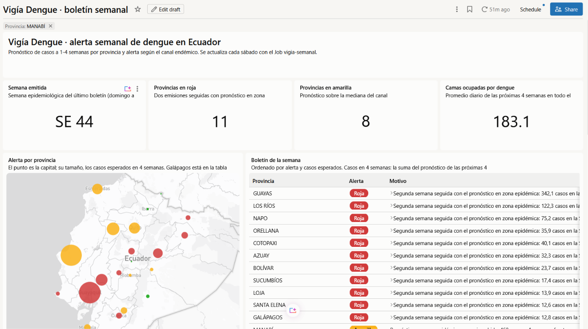
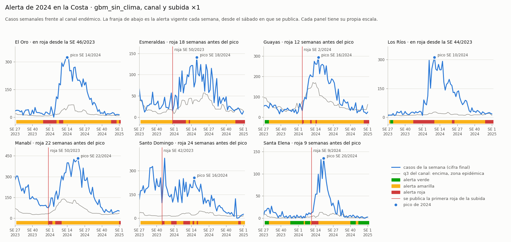

# Vigía Dengue: dengue early warning system for Ecuador on Databricks

[](https://github.com/srodriguez252/vigia-dengue/actions/workflows/ci.yml)

**With data up to 2023, Vigía Dengue would have issued a red alert for Manabí 22 weeks before the 2024 peak.**

Every Saturday it forecasts confirmed dengue cases in each of Ecuador's 24 provinces one to four weeks ahead, issues a green, yellow or red alert with its reason, and estimates the hospital bed-days those cases would take. It runs end to end on Databricks Free Edition.

> **Resumen en español.** Sistema de alerta temprana de dengue para Ecuador sobre Databricks Free Edition. Cada sábado pronostica los casos confirmados de cada provincia a 1–4 semanas, emite una alerta verde, amarilla o roja con su motivo y estima las camas-día que ocuparían. Usa datos públicos del MSP, el INEC, Open-Meteo (ERA5 de Copernicus) y NOAA. Con datos hasta 2023, habría alertado a Manabí 22 semanas antes del pico de 2024.

## The problem

- Dengue cases in Ecuador more than doubled in one year: 61,400 confirmed cases in 2024 against 27,906 in 2023 ([MSP bulletin, epi week 42 of 2025](https://www.salud.gob.ec/wp-content/uploads/2025/10/Enfermedades-Trasmitidas-por-Vectores-DNVE-SE-42.pdf)).
- The Ministry of Health's weekly bulletins describe what already happened, in PDF tables with five different layouts since 2017. None projects the weeks ahead.
- Climate gives warning: El Niño forecasts anticipated the early 2016 peak in Machala ([Lowe et al., 2017](https://par.nsf.gov/servlets/purl/10039611)), and at the time Ecuador had no official dengue early warning system ([LSHTM](https://www.lshtm.ac.uk/expert-opinion/can-climate-forecasts-predict-outbreaks)).

The decision it supports: which provinces should get vector control and supplies before the peak, not after.

## How it works



Blue boxes are the tasks of the job `vigia-semanal`, which runs every Saturday at 08:00, Ecuador time.

- **Ingestion.** Download notebooks and a GitHub Actions workflow land raw files in a Unity Catalog volume. Auto Loader reads only new files.
- **ETL.** One Lakeflow Spark Declarative Pipeline (`vigia-etl`, 20 source files) builds the bronze, silver and gold tables, with expectations that drop bad rows or stop the update.
- **Model.** A gradient boosting model, chosen by a rolling-origin backtest and registered in Unity Catalog through MLflow.
- **Weekly run.** A six-task job forecasts the weeks still missing, applies the alert rule, estimates bed-days and emails the dashboard as a PDF.
- **Operations.** The pipeline, the job and the dashboard are code in a Declarative Automation Bundle. GitHub Actions runs 26 tests on every push and deploys the bundle when they pass on `main`.

## Results

Rolling-origin backtest: one forecast per epidemiological week since week 1 of 2022, retraining every 4 weeks, with only the data published by each issue date.

**Forecast error.** Mean absolute error in cases per province and week. Every forecast cuts the endemic channel's error by 40% to 54%. The naive forecast, the average of the last 4 weeks, has the lowest error at every horizon, and the champion is within 1.2 cases of it. The champion's edge is that it anticipates rises, as the alert rules below show.

| Model | 1 week | 2 weeks | 3 weeks | 4 weeks | Relative to the endemic channel |
| --- | --- | --- | --- | --- | --- |
| Last 4 weeks (naive) | 9.8 | 11.2 | 12.5 | 14.0 | 0.46 |
| **Gradient boosting, no weather (champion)** | 11.0 | 12.0 | 13.3 | 14.3 | 0.49 |
| Gradient boosting, with weather and El Niño | 11.3 | 12.9 | 14.0 | 14.2 | 0.51 |
| Gradient boosting, one model per province | 14.2 | 15.0 | 15.8 | 16.7 | 0.60 |
| Endemic channel, median | 25.6 | 25.6 | 25.7 | 25.8 | 1.00 |

**Alert rules,** applied to the champion's forecasts. Every rule turns red when the 2–4 week forecast is above the channel's third quartile in two consecutive issues; the stricter ones also ask the 4-week forecast to reach a multiple of the last 4 weeks' average.

| Red alert rule | Sensitivity | False alarms per province-year | Coastal provinces warned in 2024 | Median coastal lead time (weeks) | Manabí |
| --- | --- | --- | --- | --- | --- |
| Above the third quartile twice in a row (the plan's rule) | 0.89 | 0.33 | 2 of 7 | 0 | Red since week 22 of 2023 |
| **Plus a 4-week forecast at least equal to the average (chosen)** | 0.33 | 0.20 | 5 of 7 | 12 | Warned 22 weeks ahead |
| Plus a 4-week forecast at least 1.25 times the average | 0.17 | 0.17 | 5 of 7 | 8 | Warned 22 weeks ahead |
| Plus a 4-week forecast at least 1.5 times the average | 0.08 | 0.13 | 4 of 7 | 11 | Not warned |
| The plan's rule on the naive forecast | 0.86 | 0.26 | 2 of 7 | 0 | Red since week 20 of 2023 |

Sensitivity is the share of epidemic weeks that had a red alert issued 2 to 4 weeks earlier. A false alarm is a run of red issues that announced no epidemic week. Lead time counts the full weeks between the publication of the first red alert of the 2024 rise and the start of the peak week; a coastal province that was not warned, or whose alert was already red from the previous season, counts as 0.

With the chosen rule, Santo Domingo de los Tsáchilas was warned 24 weeks before its peak, Manabí 22, Esmeraldas 18, Guayas 12 and Santa Elena 9. El Oro and Los Ríos were already red from the previous season.





## Design decisions

- **No look-ahead.** Each MSP bulletin is stored as a version with its cut-off date. The features of week *t* use only what had been published 7 days after the week closed, and the training labels are the case counts as known 3 weeks later. Two tests perturb everything that was not known on a given date and require identical features and forecasts.
- **A PDF parser that quarantines instead of guessing.** pdfplumber runs inside `mapInPandas` and reads five table layouts from 2017 to 2026 by the position of each number. A bulletin it cannot read with confidence goes to a quarantine table, and every bulletin with a total row is reconciled against it.
- **Rates back to cases.** From mid-2025 to mid-2026 the bulletins publish rates only. They are converted with the population the MSP itself used, deduced from its earlier bulletins, and every row says whether its cases come from the PDF or are estimated.
- **A bulletin that carries the previous year.** The total row of the bulletin for week 1 of 2025 adds all the cases of 2024 to the 547 of its own week. Weekly cases are the growth of each year's highest cumulative count, so that one bulletin gave Manabí 10,473 cases in the first week of 2025, about its whole 2024, and zero in the other 52 weeks. A bulletin from the first 4 weeks of a year is dropped when its national cumulative count reaches half of the previous year's highest count known at its cut-off date; its week is filled like any other gap, and a test reproduces the case.
- **The endemic channel as the yardstick.** For each province, year and week: the quartiles of up to 7 previous non-epidemic years ([Bortman, 1999](https://scielosp.org/pdf/rpsp/1999.v5n1/1-8/es)). It is both the baseline to beat and the threshold of the alert.
- **The model.** `HistGradientBoostingRegressor` with Poisson loss, one per horizon, shared by all provinces, with the province as a categorical feature. The backtest compared it with one model per province and with a version that adds rainfall, temperature and humidity anomalies and the lagged Niño 1+2 index. The champion is the global model with the lower mean error, the one without weather: it uses lagged cases and their growth, incidence per 100,000, the endemic channel, data-quality flags, season and population. The naive forecast and the endemic channel are baselines only, because neither can announce an epidemic rise.
- **The alert rule.** Red when, in two consecutive weekly issues, the 2–4 week forecast is above the channel's third quartile (and above 5 cases) and the 4-week forecast is at least the average of the last 4 weeks. Yellow when the forecast is above the channel's median. The backtest chose the rising-forecast condition: the most coastal lead time with at most one false alarm per province and year.
- **Bed-days.** Forecast cases × hospitalizations per case × mean length of stay, from INEC discharges and MSP cases of 2017–2024. Provinces with fewer than 30 hospitalizations use national rates.
- **Append-only weekly issues.** Each run forecasts only the issues not yet in `gold.pronosticos`, so a failed Saturday is made up the next week and past issues are never rewritten. The 80% interval comes from the backtest errors of the champion.

## Limitations

- **The model does not beat the naive forecast on error.** The average of the last 4 weeks misses by 9.8 cases a week ahead, against 11.0 for the champion, and stays ahead at every horizon. But it is flat, so it can never announce a rise: its 4-week forecast is the average itself, and the rising-forecast condition either always holds or never does. With the plan's rule it warned 2 of 7 coastal provinces of the 2024 rise, with a median lead time of 0 weeks; the champion with the chosen rule warned 5, with 12.
- **Weather did not improve the forecast.** With weather and El Niño the error moved by less than one case per province and week: slightly higher at 1 to 3 weeks and slightly lower at 4 (14.2 against 14.3). The champion therefore uses case history and the endemic channel only. The rainfall bias below and a history that starts in 2017 may explain part of it.
- **Rainfall is biased in the Andes.** ERA5 cells of about 28 km mix valleys and slopes: Quito adds up to 3,518 mm in 2025 against a normal of about 1,100 mm. That is why rainfall enters the model as an anomaly against its own climatology.
- **The chosen rule trades sensitivity for timing.** It catches 33% of epidemic weeks 2 to 4 weeks ahead, against 89% for the plan's rule, because it only turns red on a rising forecast. That condition is what lets it warn 5 of 7 coastal provinces of the 2024 rise instead of 2.
- **Saturated alerts.** Manabí's cases were above its epidemic threshold every week from week 21 of 2023 to the end of 2024 (84 weeks), and with the plan's rule its alert stayed red from week 22 of 2023. A province already in red cannot be warned again, so lead time is measured from the 2024 rise.
- **The bulletins have gaps.** From 2017 to 2026, 21 weeks were never posted, 3 links are broken and 4 PDFs cannot be read, and figures are revised in later bulletins. The growth across a gap is spread evenly over its weeks.
- **Hospital data arrive late.** INEC discharges are published more than a year later, so they calibrate bed-days but do not feed the weekly forecast. Bed-days are an order of magnitude, not a capacity plan.
- **Short channel history.** The endemic channel needs at least 5 previous years, so it starts in 2022 or 2023 depending on the province.
- **Free Edition limits.** Serverless compute only, one pipeline, limited outbound internet, and Open-Meteo's free tier for non-commercial use, which spreads the weather history over several days.

## Repository layout

| Path | What it holds |
| --- | --- |
| `vigia-etl/transformations/` | Lakeflow pipeline: bronze, silver and gold tables |
| `vigia-etl/utilities/features.py` | Weekly cases, endemic channel and features, shared by the pipeline and the tests |
| `src/modelos/` | Backtest, baselines, alert rule and metrics (`pronostico.py`); weekly forecast, interval and bed-days (`semanal.py`) |
| `src/notebooks/` | Downloads, backtest, model registration, weekly forecast and alert |
| `src/dashboards/` | AI/BI dashboard definition |
| `src/setup/` | Catalog, schemas and volume; the 221 cantons with their weather point (`cantones.csv`) |
| `databricks.yml`, `resources/` | Declarative Automation Bundle: pipeline, job and dashboard |
| `tests/` | pytest suites: no-leakage tests, backtest and weekly bulletin |
| `scripts/` | Niño download and the generator of `cantones.csv` |
| `.github/workflows/` | Weekly Niño download; CI that tests and deploys the bundle |

## Run it yourself

You need a Databricks workspace (Free Edition works), the Databricks CLI 1.22 or later logged in with the `DEFAULT` profile, and a fork of this repository.

1. Run `src/setup/00_crear_catalogo.sql` in the SQL editor: catalog `vigia`, schemas `bronze`, `silver`, `gold` and `ml`, and the volume `landing`.
2. Add your fork as a Git folder in the workspace.
3. Copy the cantons to the volume, then load the history once by running these notebooks from `src/notebooks/`: `descargar_egresos`, `descargar_poblacion`, `descargar_gacetas` and `descargar_clima`. The weather history needs several runs because of Open-Meteo's free quota; the notebook resumes where it stopped. The Niño index comes from the script that GitHub Actions runs every Tuesday:

   ```bash
   databricks fs cp src/setup/cantones.csv dbfs:/Volumes/vigia/bronze/landing/geografia/cantones.csv
   python scripts/descargar_fuentes.py --fuente nino --destino landing
   databricks fs cp -r landing dbfs:/Volumes/vigia/bronze/landing --overwrite
   ```

4. Put your SQL warehouse ID in `resources/vigia_dengue.dashboard.yml` and `resources/vigia_semanal.job.yml`, then deploy and build the tables:

   ```bash
   databricks bundle deploy -t prod
   databricks bundle run vigia_etl -t prod
   ```

5. Run the notebooks `backtest`, `por_provincia`, `alertas` and `registrar`, in that order. They write the backtest tables and register `vigia.ml.pronostico_dengue` with the alias `champion`.
6. Run the weekly job once: `databricks bundle run vigia_semanal -t prod`. After that it runs every Saturday on its own.
7. For CI, add the repository secrets `DATABRICKS_HOST` and `DATABRICKS_TOKEN`. To run the tests locally (Python 3.12 and Java 17):

   ```bash
   pip install pyspark==4.0.1 pytest==8.4.2 scikit-learn==1.7.2 pandas==2.3.3 numpy==2.3.4 matplotlib==3.10.6
   pytest tests
   ```

## Data sources and licenses

The repository does not redistribute raw data: the notebooks download each source into a Unity Catalog volume. The only derived dataset stored here is `src/setup/cantones.csv`.

| Source | Used for | License |
| --- | --- | --- |
| [MSP, weekly bulletins of vector-borne diseases](https://www.salud.gob.ec/gacetas-vectoriales-2026/), 2017–2026 | Confirmed dengue cases by province and week | Public bulletins of Ecuador's Ministry of Public Health |
| [INEC, hospital beds and discharges](https://www.ecuadorencifras.gob.ec/camas-y-egresos-hospitalarios/), 2015–2024 | Hospitalizations and length of stay for bed-days | Public data of Ecuador's national statistics institute |
| [INEC, population estimates and projections, 2024 revision](https://www.ecuadorencifras.gob.ec/estimaciones-y-proyecciones-de-poblacion-revision-2024/) | Population by canton and year | Public data of Ecuador's national statistics institute |
| [Open-Meteo Historical Weather API](https://open-meteo.com/) | Daily temperature, rainfall and humidity per canton | [CC BY 4.0](https://creativecommons.org/licenses/by/4.0/) |
| Copernicus Climate Change Service, ERA5 and ERA5-Land, through Open-Meteo | The reanalysis behind the weather data | [CC BY 4.0](https://creativecommons.org/licenses/by/4.0/) |
| [NOAA Climate Prediction Center, weekly Niño indices](https://www.cpc.ncep.noaa.gov/data/indices/) | Niño 1+2 sea surface temperature anomaly | U.S. Government data |
| CONALI, Organización Territorial del Estado (17 July 2026), through [geoecu](https://cran.r-universe.dev/geoecu) | Canton seats in `cantones.csv` | CC BY |
| [GeoNames](https://www.geonames.org/) | Most populated place of each canton seat in `cantones.csv` | [CC BY 4.0](https://creativecommons.org/licenses/by/4.0/) |

### Attribution

- [Weather data by Open-Meteo.com](https://open-meteo.com/). Zippenfenig, P. (2023). *Open-Meteo.com Weather API* [Computer software]. Zenodo. <https://doi.org/10.5281/ZENODO.7970649>
- Contains modified Copernicus Climate Change Service information 2026. Neither the European Commission nor ECMWF is responsible for any use that may be made of the Copernicus information or data it contains.
  - Hersbach, H., et al. (2023). *ERA5 hourly data on single levels from 1940 to present*. Copernicus Climate Change Service (C3S) Climate Data Store (CDS). <https://doi.org/10.24381/cds.adbb2d47>
  - Muñoz Sabater, J. (2019). *ERA5-Land hourly data from 1950 to present*. Copernicus Climate Change Service (C3S) Climate Data Store (CDS). <https://doi.org/10.24381/cds.e2161bac>
- Canton boundaries: Comité Nacional de Límites Internos (CONALI), Ministerio de Gobierno del Ecuador, *Organización Territorial del Estado*, version of 17 July 2026, CC BY, as published by the geoecu package.
- Places: [GeoNames](https://www.geonames.org/), CC BY 4.0, through the cities500 file of the geonamescache package.
- Niño 1+2 index: NOAA Climate Prediction Center, weekly OISST v2.1, 1991–2020 base period.
- Dengue cases: Ministerio de Salud Pública del Ecuador, *Gacetas epidemiológicas de enfermedades vectoriales*.
- Hospital discharges and population: Instituto Nacional de Estadística y Censos (INEC).

**Changes made.** Weather is aggregated to epidemiological weeks, weighted by canton population and expressed as anomalies against each province's own climatology. `cantones.csv` derives one point per canton: the GeoNames place with the most people inside the canton seat's CONALI polygon, or the polygon's centroid when there is none.

## Disclaimer

Portfolio project, not an official health alert. It uses aggregated public data only, with no personal information. Forecasts and bed-days carry the uncertainty described above and should not drive real decisions without the Ministry of Health's own surveillance.

## License

Code under the MIT License (see [LICENSE](LICENSE)). The data keep the licenses of their sources.
